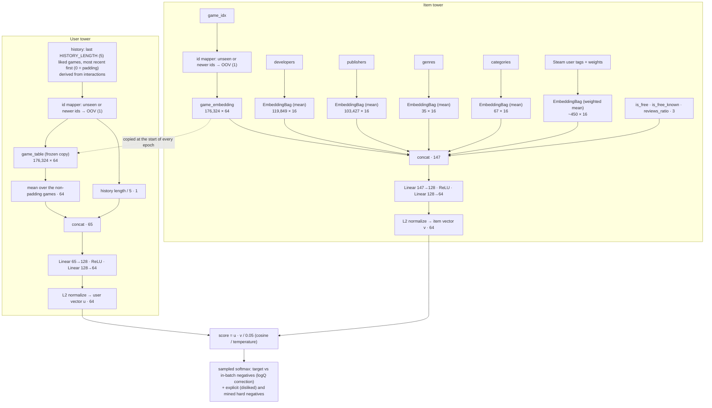
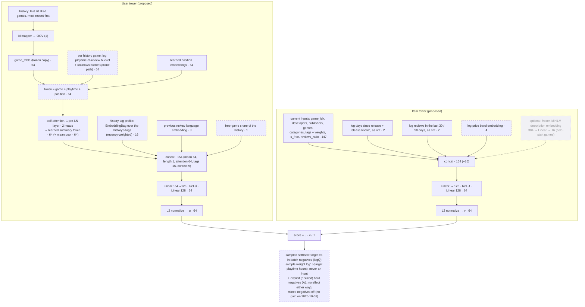
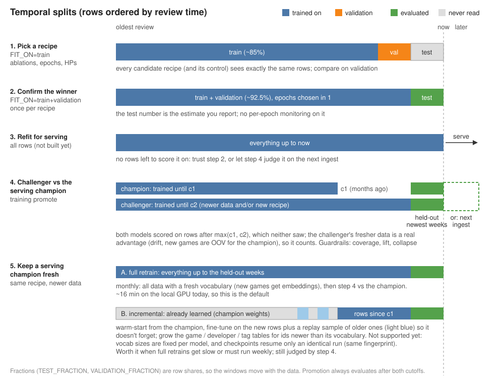

# Training

Two-tower retrieval model trained on the ETL marts (`steam_marts.interactions`, `game_features`,
`lkp_*`, Iceberg) in SageMaker training jobs. It runs outside the weekly Step Function: the
*training CD* workflow trains a model, and *training promote* evaluates it against the champion
and swaps it in when it is better.

```
Iceberg marts ──(pyiceberg, Glue catalog, streamed)──► 1. dataset + temporal split (last ~10% = validation)
                                                       2. training examples → DataLoader / collate
                                                       3. training (in-batch + hard negatives, checkpointed)
                                                       4. evaluation (recall@K vs full catalog)
                                                       ──► s3://model-artifacts-<acct>/models/<sha>/
```

The same entry point (`python -m steam_training train|promote`, `__main__.py`) runs in the
SageMaker job and on a workstation. `launch.py` only *starts* SageMaker jobs, from the workflows.

## Data loading and scale

`interactions` is streamed in Arrow batches, pinned to one Iceberg snapshot, and memory scales with
the rows **kept** (`data.py`):

1. `timestamp`, `is_positive` only → the temporal cutoff, and a sampling rate that caps the
   validation rows at `EVAL_MAX_ROWS`.
2. Every column, filtered batch by batch: warm training positives, `COLD_ROW_FRACTION` of the
   cold ones, training negatives as `(user, game)` only, and the sampled validation positives.
   Positive counts per game (popularity baseline, logQ) cover every training row.
3. `game_features` rows before the cutoff, reduced to the latest row per game (the catalog),
   joined by `game_idx` with each game's current Steam user tags (mart `game_tags`,
   `USE_GAME_TAGS`). A target's list features (developers, genres, tags, …) come from the
   catalog, since they are static per game. `game_reviews_ratio` / `game_is_free` stay per row,
   as of the review.
4. `timestamp`, `user_id`, `game_idx` → each validation user's reviews: their activity
   (reviews before the cutoff, for the activity buckets) and, per validation row, every game
   they reviewed before it (excluded from that row's candidates). Only the validation users'
   reviews are kept: roughly their total review count × 24 B while loading.

Measured on 2.67M interactions: 1.4 GB peak for loading (mostly the Arrow reader's per-file
buffers), 71 MB of kept arrays (~27 B per interaction). About 5 GB is expected at 100M reviews,
so it fits a workstation or `ml.m5.2xlarge` (32 GB). Time is bounded by `MINE_MAX_ROWS` examples
re-mined per epoch and by `EVAL_MAX_ROWS`. Training itself grows linearly: about 30 s per epoch
per 2.7M interactions on 16 CPU cores.

**Devices.** `DEVICE=auto` uses CUDA when present, otherwise the CPU. torch comes from one of two
uv extras: `cpu` (default image, CI) or `cu128` (GPU image, built with
`--build-arg TORCH_VARIANT=cu128` and tagged `<sha>-cu128`). The cu128 index stops at torch 2.11
while cpu has 2.14. Artifacts are plain state dicts, so they load in either.

**Checkpoints.** After every epoch the full training state (model, optimizer, mined negatives,
losses) goes to `checkpoints/<model_id>/checkpoint.pt`. Re-running the same `MODEL_ID` resumes
after the last finished epoch when its fingerprint matches (Iceberg snapshots, cutoff and the
settings that change training; `EPOCHS` and the evaluation settings excluded, so a finished run
can be extended). Random streams are reseeded per epoch, so a resumed run equals an uninterrupted
one. The checkpoint is kept after the model is saved, so a finished run is extended by re-running
the same `MODEL_ID` with a higher `EPOCHS` (only the new epochs train; the model and its metadata
are overwritten). It expires after 14 days (bucket lifecycle), and a new dbt run changes the
snapshots, so extend before the next pipeline run. A checkpoint past `EPOCHS` is ignored (the
run starts over). `RESUME=false` always starts over.

## Model

Dimensions of the current champion (`models/champion/metadata.json` → `config`); the
vocabulary sizes grow with the catalog.



| Tower | Input | Architecture |
|---|---|---|
| User | the last `HISTORY_LENGTH` (5) positively reviewed games before the review, derived from `interactions` | mean pooling over a **frozen copy** of the item tower's game embedding table + history length → MLP → L2 norm |
| Item | `game_idx`, `game_developers`, `game_publishers`, `game_genres`, `game_categories`, `game_tags` + `game_tag_weights`, `game_is_free`, `game_reviews_ratio` | game embedding + mean-pooled attribute embeddings (`EmbeddingBag`) + the tag embeddings averaged with the game's normalized tag weights + numerical features → MLP → L2 norm |

- **Shared game table, synced per epoch.** The user tower reads the item tower's game
  embeddings through a snapshot that is copied at the start of every epoch. Within an epoch the
  user tower trains against a fixed target, which avoids the unstable gradients of both towers
  updating one table in every step.
- **Loss.** Sampled softmax with cosine similarity / temperature. The negatives are the other
  targets in the batch (with logQ popularity correction) plus two hard negatives per example:
  - *explicit*: a game the same user reviewed negatively (`is_positive = false`, training split);
  - *mined*: sampled from ranks `[MINE_SKIP_TOP, MINE_SKIP_TOP + MINE_POOL_SIZE)` of the current
    model, re-mined every epoch from epoch `MINING_START_EPOCH` on. The top ranks are skipped
    because they are the likeliest false negatives.

  A batch item that is the same game as the target, or a game in the user's history, is never
  used as a negative.
- **Cold start.** About a third of the training positives (~35%, ~33M of 94M on the 2026-11
  data; 49% on 2026-09, before the backfill lengthened histories) are a user's first positive
  review (empty history).
  Inference never sees an empty history, so training keeps every warm row and only
  `COLD_ROW_FRACTION` of the cold ones. Those rows teach one "no history" query, a fallback
  ranking. `HISTORY_DROPOUT` randomly truncates warm histories so short histories are learned
  well. Games without training interactions, and ids newer than the model's vocabularies, map to
  OOV (id 1). `ITEM_ID_DROPOUT` trains that OOV row, so new games are ranked by their content
  features.
- **Steam user tags** (spec 8, `USE_GAME_TAGS=true` by default). Genres are too coarse ("Action"
  is on most AAA games); players' tags ("Psychological Horror", "Story Rich", "Noir") separate
  them. Steam's tag weights are normalized to sum 1 per game, so the bag is a weighted mean
  (`mode="sum"` + `per_sample_weights`). `VocabSizes.tags` is `None` for models trained without
  tags: they build no tags module and still load (no architecture version bump). Promotion
  loads the tags whenever the candidate or the champion uses them.
- Every embedding table is in memory (176k games, 120k developers, 103k publishers, 35 genres,
  67 categories on the 2026-09 data); features
  come from the marts as integer ids (see `etl/README.md`).

## Proposed architecture (spec 17 findings)

A proposal derived from the EDA in `notebooks/01_feature_questions.ipynb`. Each section of that
notebook tests a feature against a null model. Nothing below ships until it beats the champion in
an ablation. Every change is one experiment, so this depends on experiment tracking (spec 18).
Dashed boxes are not built yet. A3 (history + attention), A4 (tag profile), A6 (recency) and A7
(language) are built; A2 (disliked games as tokens) and the A3 time gaps were rejected and are no
longer in the diagram.
Every result is in the [experiment log](#experiment-log).



| # | Change | EDA evidence (5% of users, 6M reviews) | Needs |
|---|---|---|---|
| A1 | Drop explicit negatives from the retrieval loss | Disliked games fit the user's liked games almost as well as liked ones (90% of the way from random to positive), and the next pick stays as close after a dislike as after a like (Q7). They mark interest, so as negatives they push the user away from games they'd engage with. | `EXPLICIT_NEGATIVES=false`. **Rejected (2026-11-12)**: warm recall@50 0.1787 vs 0.1804 for a control on the same split (2 epochs, 5-game exclusion), behind at every K and almost every activity bucket. Explicit negatives stay on. That gap (−0.9%, one seed, old 5-game recipe) is inside the ~0.8% seed noise measured later. **Re-tested (2026-11-17)** on the current recipe, two seeds: +1.6% / −1.7%, mean −0.1%. No effect either way, so explicit negatives stay on (the recipe is unchanged) |
| A2 | Disliked games as history tokens with a learned "disliked" offset | Same as A1: interest, with the dislike kept as information. The ranker (spec 9) learns like vs dislike (label 0). Variants: plain tokens (no flag), additive offset `flag × w` (one 64-d vector shared by every disliked token), or a gate `token × (1 − flag·α)` with α learned in [0, 1], which can only shrink a disliked game's weight. | `HISTORY_DISLIKED=plain\|offset\|gate` (built for the test, then removed). **Rejected (2026-11-16)**: within ±0.5% of the control on two seeds for every variant, coverage@50 −8% to −9%, see the [experiment log](#experiment-log) |
| A3 | Self-attention over a longer, ordered history | The previous game is 21% more similar to the next one than the game 20 reviews back. With shuffled order there's no decay (Q5). 22% of consecutive reviews are written the same day, hence the time-gap embedding. | `HISTORY_LENGTH=N` + `HISTORY_ENCODER=attention` (built 2026-11-12, see below). Training derives the long history from `interactions`, so experiments need no ETL change. Served: inference derives the same history from `interactions`, serving runs the attention in numpy (user tower format 3); deploy serving and inference before promoting one. Time-gap embedding **rejected (2026-11-14)**, see below |
| A4 | History tag profile | 42% of heavy users are more concentrated on one tag than 95% of shuffled users. Tags separate users better than genres (Q1). | `USER_TAG_PROFILE=true`. **Accepted (2026-11-12)**: warm recall@50 0.1996 vs 0.1826 for a control on the same split (+9.3%, full-history exclusion, 2 epochs), +4% for new users rising to +40% / +76% for the top 5% / 1% most active, coverage@50 0.105 vs 0.053. Learned recency: the most recent game's tags weigh 1.67× the oldest's. Built over the 5-game history; the whole-history profile needs the longer history of A3. Promotable: its `user_tower.npz` is numpy format 2 (+ the tag lookup, table and position weights), which serving reads from the serving release that added it, so deploy serving first |
| A5 | Playtime at review: an attribute of each history token + log1p sample weight on the target | Playtime tracks taste fit (ρ +0.07) and liking (ρ +0.14). Votes don't (ρ −0.02) and grow with review age (Q2, E1). It belongs to a (user, game) interaction: on history tokens it describes past interactions, so the user tower can compute it without the candidate; on the target it only weights the loss, never an input (it's the outcome). `POST /recommendations` sends liked games without playtime, so the token needs an "unknown" bucket, also used as dropout in training. Only `playtime_at_review`: `playtime_forever` is measured at scrape time, after the review. | `playtime_at_review` in `interactions` |
| A6 | Recent popularity (30 / 90 days) and game age, as of t | Top-100 games overlap only 62% between consecutive 90-day windows. 31% of recent reviews go to games released in the last year (E3). Reviews are 1.4× front-loaded in the first year, and the positive rate drops 5 points after a game's first 90 days (Q3). `ITEM_RECENCY=true` (counts from `interactions` for the test; `game_popularity_weekly` to ship). **Accepted (2026-11-17)**: +34% (two seeds), +39% with A7, see the [experiment log](#experiment-log) |
| A7 | User language + free share | Non-English reviewers pick games whose reviewers mostly share their language 17% of the time vs 6% by chance (E4). Users lean free / paid beyond chance (Q4). `USER_LANGUAGE=true`, language of the previous review (raw reviews for the test; a `review_languages` mart to ship). Free share not built. **Accepted (2026-11-17)**: +3.3% alone, +3.6% on top of A6 |
| A8 | Description embedding (optional) | Neighbours share 2.7× more tags than random pairs, but co-liked AUC goes from 0.623 to only 0.627 on top of tags (Q6). Only worth it for games with few tags. | precomputed embeddings per game |

Cross features (user × candidate) can't go in a two-tower model, because the towers only meet at
the final dot product: developer already in the history (E2: 9.5% repeat vs 3.3% shuffled), tag
overlap between the history and the candidate, the user's playtime on the candidate's tags. They
belong to the ranker (spec 9).

Not proposed: review votes as weights (Q2) and text sentiment of top reviews. The latter predicts
the future positive ratio no better than the past ratio does: R² 0.685 → 0.686 (Q8). `game_price`
and `votes_*` are measured at scrape time, so they are not as-of-t features.

Suggested order (cheapest first, each against the champion on warm recall@50): A1 → A4 → A5 →
A6 → A3 + A2 → A7 → A8. A1, A4 and (for training) A3 need no ETL change. Status (2026-11-17):
A4, A3, A6 and A7 accepted (A6 + A7 together is the next recipe, pending marts and serving
support), A1, A2 and the A3 time gaps rejected (A1: no effect); A5 (playtime) and A8 not tried. A3's settings are
optional `ModelConfig` fields whose defaults are the old layout (like tags and A4), so older
models keep loading without an `ARCHITECTURE_VERSION` bump.

A3 encoder (`model.HistoryAttention`): the history games from the frozen game table + a learned
position embedding (0 = most recent), a learned summary token in front, `ATTENTION_LAYERS`
pre-LN blocks (multi-head self-attention with padding masked as keys, ReLU FFN of 2× width),
LayerNorm. The summary token's output is appended to the mean-pooled history (kept, so attention
can only add to the baseline) before the user MLP. Written out by hand so a numpy port can
mirror it. The A4 tag profile gets one learned position weight per slot of the longer history.

## Experiment log

Every approach tried on the retrieval model, newest last. Accepted ones are in the champion's
recipe; rejected ones were removed from the code (the README keeps how they worked). The
metric is warm recall@50 on ~350k validation rows, against a control trained on the same
snapshot and split. Models are `local-<sha>-…` in the bucket and runs are in MLflow (experiment
`steam-two-tower`; the setting that names the arm is the run's param, e.g. `batch_size`).

| Date | Approach | Verdict | Evidence |
|---|---|---|---|
| 2026-10-03 | `LEARNING_RATE` 2e-2 vs 5e-3 | no difference, 5e-3 kept | every run peaks at epoch 2 (~0.182, cutoff 2026-03-31, 61M positives, batch 4096) |
| 2026-10-03 | `MINED_NEGATIVES` on vs off | **rejected**, off in every recipe since | same loss and recall, +70 s per epoch |
| 2026-10-03 | Keep the best epoch + early stopping (`KEEP_BEST_EPOCH`, `EARLY_STOPPING_PATIENCE=1`) | **accepted** | every run peaked before the last epoch, which training used to save |
| 2026-11-12 | A1: `EXPLICIT_NEGATIVES=false` | rejected, re-tested on 11-17 | 0.1787 vs 0.1804 (−0.9%), one seed, 5-game recipe: within the seed noise found on 11-14 |
| 2026-11-12 | `USER_TABLE_SYNC_STEPS=1000` (user tower's game table re-synced within the epoch) | **accepted** | 0.1826 → 0.1894 (+3.7%); every run now peaks after epoch 1 |
| 2026-11-12 | A4: `USER_TAG_PROFILE=true` | **accepted** | +9.3% alone, 0.2118 with the sync (+16% vs control), coverage@50 0.053 → 0.124 |
| 2026-11-12 | A3: `HISTORY_LENGTH` 20 / 50, `HISTORY_ENCODER=attention` | **accepted** (champion: 20 + attention) | 20 + attention 0.2229 (+5.9%), 50 + attention 0.2249 (+6.9%) at 1.6× the epoch time |
| 2026-11-14 | A3 time-gap embedding | **rejected** | +1.7% / −0.0% on two seeds, coverage −11% / −18% |
| 2026-11-14 | Training speed: pinned async copies, fused Adam, no per-step host sync | **accepted** (engineering, same update rule) | epoch 607 → ~460 s |
| 2026-11-14 | `BATCH_SIZE` 8192 / 16384 | **rejected** | mean within +0.3% of the control, coverage −8% / −11%, epochs 1.4× / 2.1× slower |
| 2026-11-16 | A2: disliked games as history tokens (plain / offset / gate) | **rejected** | every variant within ±0.5% on two seeds, coverage −8% to −9% |
| 2026-11-17 | A1 re-test on the current recipe | **rejected** (no effect; explicit negatives stay on) | +1.6% / −1.7% on two seeds, mean −0.1%; epochs ~4% faster without them |
| 2026-11-17 | A6: item recency as of t (reviews in the last 30 / 90 days, game age), one week per batch | **accepted** | +25% / +43% on two seeds (mean +34%), third seed +21%; all-rows recall@50 0.20 → 0.31; the first try (mixed weeks per batch) learned a date shortcut, −16% |
| 2026-11-17 | A7: language of the user's previous review | **accepted** | +2.6% / +4.0% on two seeds (mean +3.3%) |
| 2026-11-17 | A6 + A7 together | **accepted** (next recipe, not promotable yet) | +5.4% / +2.1% over A6 alone on the same seeds; +39% over the control; above the control in every activity bucket |

Before 2026-11-14 each arm ran on one seed. Gains of +3.7% and more are far outside the
~0.8% seed noise; A1, the one small single-seed verdict, was re-tested with two seeds.

Coverage@50 is noisier across seeds than recall. Over the 16 runs on the shared snapshot
(2026-11-14 to 11-17) it ranges 0.141–0.161 on seed 42 and 0.145–0.184 on seed 43, and the
seed-43 control (0.184) is the highest of all of them. Most of the "coverage −8% to −11%"
against the controls above comes from that one run (vs the seed-42 control alone, the arms are
−4% on average). Judge arms on warm recall; read coverage only as a large, consistent move.

A6 and A7 are compared on identical rows: `compare_models.py` scores every saved model, the
popularity baseline and the weekly recent-popularity baseline on one validation sample after
every model's cutoff (499k rows). Their training runs read `interactions` snapshot
5387310200131862803, a rebuild of the controls' snapshot with the same rows (the marts were
rebuilt on 2026-11-17 for `game_popularity_weekly`), so the controls stayed valid.

**Shared controls since 2026-11-14** (champion recipe: 20 games, attention, A4, sync every 1000
steps, lr 5e-3, batch 4096, cutoff 2026-05-09, `interactions` snapshot 1483226419950901524):
`local-8dde901-a3-len20-attn-control` (seed 42, 0.2187, coverage 0.158) and
`local-8dde901-a3-len20-attn-control-s43` (0.2205, 0.184). Each new arm runs seeds 42 and 43
and is compared with the control of the same seed while the snapshot stays the same (the marts
keep 2 snapshots, so a rebuild needs fresh controls).

### A1 / A4 / A3 results (2026-11-12)

Cutoff 2026-05-01, full-history exclusion, warm recall@50 on 500k validation rows:

| Run | Epochs | warm recall@50 | coverage@50 |
|---|---|---|---|
| control (champion settings) | 2 | 0.1826 | 0.053 |
| A1: no explicit negatives (old exclusion, vs its control 0.1804) | 2 | 0.1787 | 0.050 |
| control + `USER_TABLE_SYNC_STEPS=1000` | 1 | 0.1894 | 0.082 |
| A4: `USER_TAG_PROFILE=true` | 2 | 0.1996 | 0.105 |
| **A4 + `USER_TABLE_SYNC_STEPS=1000`** | **1** | **0.2118** | **0.124** |

With the in-epoch sync every run peaks after epoch 1 (2 epochs: control 0.1801, A4 0.2027, back
when training kept the last epoch). `KEEP_BEST_EPOCH` (default) now saves the best monitor
epoch and `EARLY_STOPPING_PATIENCE=1` stops one epoch after the peak. The gain grows
with activity: A4 + sync is +5% for new users and +82% for the top 1% (0.0622 vs 0.0341).

A3 on top of A4 + sync (`USER_TAG_PROFILE=true USER_TABLE_SYNC_STEPS=1000`, early stopping,
every run kept epoch 1; base: `local-25f831c-a4-sync1k-best`, 5 games, 0.2104):

| Run | Epoch | warm recall@50 | 6–17 / 18–58 / 59–175 reviews / top 1% | coverage@50 |
|---|---|---|---|---|
| `HISTORY_LENGTH=20` | 445 s | 0.2179 (+3.6%) | +8.4% / +12.1% / +11.6% / +3.2% | 0.142 |
| `HISTORY_LENGTH=20 HISTORY_ENCODER=attention` | 586 s | 0.2229 (+5.9%) | +11.5% / +17.0% / +14.7% / +12.6% | 0.160 |
| `HISTORY_LENGTH=50` | 533 s | 0.2189 (+4.0%) | +8.5% / +15.2% / +13.2% / +5.5% | 0.142 |
| **`HISTORY_LENGTH=50 HISTORY_ENCODER=attention`** | 962 s | **0.2249 (+6.9%)** | +12.1% / +19.2% / +18.4% / +12.4% | 0.153 |

The longer history drives most of the gain (5 → 20 games); 20 → 50 adds little with the mean.
Attention adds +2.3% / +2.7% on top, most for the heaviest users (order and recency matter,
EDA Q5). Users with no history are unchanged. The derived histories match the mart's 5 games on
99.99% of validation rows. Promotable once serving (format 3) and inference (derived
histories) are deployed: numpy vs torch on the 50-game model differ by at most 1.2e-7, and one
embedding takes ~0.7 ms.

**A3 time gaps: rejected (2026-11-14).** Each history token also got a learned embedding of the
log-bucketed gap to the user's previous positive review (11 buckets, <1h to >=1y, plus "unknown"
for first reviews and gap dropout 0.1 for the timestamp-less online path). The gap depends only
on review timestamps, never on when inference runs. Against a control with the champion's
recipe (20 games, attention, A4 + sync1k) on the same snapshot and rows, two seeds each
(cutoff 2026-05-09):

| Seed | warm recall@50 control → gaps | warm recall@100 | coverage@50 |
|---|---|---|---|
| 42 | 0.2187 → 0.2223 (+1.7%) | +1.6% | 0.158 → 0.141 (−11%) |
| 43 | 0.2205 → 0.2204 (−0.0%) | +0.6% | 0.184 → 0.151 (−18%) |

The control alone moves 0.8% between seeds, as much as the mean gain (+0.8%), and no activity
bucket improves on both seeds by more than that. Coverage drops on both: the model leans on
popular games, which also lifts cold rows (+4.2% / +2.6%) although gaps can't reach them.
Lesson for later experiments: differences under ~1% on one seed are noise, run two per arm.

**Batch size: rejected (2026-11-14).** `BATCH_SIZE` 8192 and 16384, with
`USER_TABLE_SYNC_STEPS` scaled to keep one sync per ~4M examples (500 and 250), everything else
at the champion's recipe (lr 5e-3 too), against the shared controls:

| Batch | warm recall@50 seed 42 / 43 (vs control) | mean | coverage@50 (mean) | epoch |
|---|---|---|---|---|
| 4096 (controls) | 0.2187 / 0.2205 | 0.2196 | 0.171 | ~460 s |
| 8192 | 0.2227 (+1.8%) / 0.2180 (−1.2%) | 0.2203 | 0.158 | 630 s |
| 16384 | 0.2184 (−0.1%) / 0.2212 (+0.3%) | 0.2198 | 0.152 | 972 s |

Larger batches are slower per epoch, not faster. The in-batch logits and their masks (the
target collisions, one comparison per history slot, the cross-entropy) are [B × B], so that
part of an epoch costs N·B: the times fit 290 s + 170 s × B / 4096. After the speed fix there is
little per-step overhead left for a larger batch to amortize. A higher lr for the larger batches
(fewer steps per epoch) was not tried, given the cost.

**A2 disliked games as history tokens: rejected (2026-11-16).** The history held the last 20
reviews of either polarity, disliked games stored as `-game_idx`. Training rows, validation rows
and warm / cold stayed defined by liked games only, so the rows matched the controls exactly.
Three variants of a disliked token (also applied to the A4 tag profile):

- `plain`: the game's embedding, no flag;
- `offset`: + one learned 64-d vector shared by every disliked token (starts at zero);
- `gate`: × (1 − α), α = sigmoid of one learned scalar (starts at 0.5).

Explicit negatives stayed on (A1). Against the shared controls:

| Variant | warm recall@50 seed 42 / 43 (vs control) | mean | coverage@50 (mean) |
|---|---|---|---|
| control (liked only) | 0.2187 / 0.2205 | 0.2196 | 0.171 |
| plain | 0.2195 (+0.4%) / 0.2201 (−0.2%) | 0.2198 | 0.155 |
| offset | 0.2148 (−1.8%) / 0.2224 (+0.9%) | 0.2186 | 0.158 |
| gate | 0.2192 (+0.2%) / 0.2199 (−0.3%) | 0.2195 | 0.156 |

The models used the dislikes but gained nothing from them. Both gates learned α = 0.19: a
disliked game counts 81% as much as a liked one, in line with the EDA (disliked games fit a
user's taste almost as well as liked ones, Q7). The learned offset grew to 3.7× the length of a
game vector (1.07 vs 0.29), so a disliked token became mostly a generic "disliked" marker. The
interest a dislike signals is already in the 20 liked games, and the dislikes take ~3 of the
20 slots from liked games, which costs coverage. Epoch time was unchanged (~460 s). Cold rows
can hold dislikes in this setup, so their recall is not comparable with the controls.

**A1 re-test: no explicit negatives, rejected (2026-11-17).** `EXPLICIT_NEGATIVES=false` on the
champion's recipe (no other change), against the shared controls:

| Seed | warm recall@30 | warm recall@50 (vs control) | warm recall@100 | coverage@50 | epoch |
|---|---|---|---|---|---|
| 42 | 0.1710 (+2.0%) | 0.2222 (+1.6%) | 0.3085 (+2.2%) | 0.161 (control 0.158) | 445 s |
| 43 | 0.1658 (−1.8%) | 0.2167 (−1.7%) | 0.3003 (−1.1%) | 0.154 (control 0.184) | 435 s |

The two seeds move by the same amount in opposite directions at every K (mean −0.1% at 50), so
the disliked game as a hard negative neither helps nor hurts. It also costs little (epochs ~4%
slower with it). Without a gain there is no reason to change the champion's loss, so explicit
negatives stay on. With A2 rejected too, a user's dislikes add nothing measurable to retrieval
in either role, as a negative or as history; they remain as labels for the ranker (spec 9).

**A6 item recency: accepted (2026-11-17).** `ITEM_RECENCY=true`: the item tower also reads 4
numbers per game, as of a day: log1p reviews in the 30 and 90 days before it, log1p days since
release, and whether the release date is known (each × 0.1). Counts come from `interactions`
(reviews per game and day, any polarity), release dates from `game_details`.

The first try computed every candidate's features as of its row's review day, with rows of all
dates mixed in a batch. It learned a shortcut: an in-batch negative from another row carried
features of another date, so the model could reject it for its date rather than its fit. Loss
fell, warm recall@50 fell to 0.1836 (−16%). The fix, kept:

- every batch comes from one time bucket (a week; sparse old weeks are merged, 707 buckets),
  shuffled within the bucket, and the batches are shuffled across buckets;
- every candidate in a batch (targets, in-batch and hard negatives) gets its features as of the
  bucket's start, so dates can't separate them;
- logQ uses the target frequencies of the bucket, not of the whole training set;
- evaluation refreshes the catalog's recency weekly: each validation row is scored against the
  catalog as of its week's start (`evaluation.recency_rescore`), as inference would with a
  weekly run.

A fairer baseline came with it: **weekly recent popularity** (the games with the most reviews in
the 30 days before each row's week), much stronger than all-time popularity. Results on the
same 499k rows:

| Model | warm recall@50 (seed 42 / 43 / 44) | warm recall@100 | all recall@50 | coverage@50 |
|---|---|---|---|---|
| control | 0.2200 / 0.2202 / – | 0.303 | 0.203 | 0.158 / 0.183 |
| A6 | 0.2760 (+25%) / 0.3157 (+43%) / 0.2673 | 0.380 / 0.421 / 0.376 | 0.306 / 0.336 / 0.293 | 0.165 / 0.146 / 0.176 |
| popularity (all time) | 0.1027 | 0.150 | 0.123 | |
| recent popularity (weekly) | 0.2122 | 0.301 | 0.268 | |

Recall@50 by activity (reviews before the cutoff):

| Model | new | 1–5 | 6–17 | 18–59 | 60–177 | 178+ |
|---|---|---|---|---|---|---|
| control (s42 / s43) | 0.190 / 0.194 | 0.233 | 0.215 | 0.173 | 0.130 / 0.132 | 0.071 / 0.067 |
| A6 s42 / s43 / s44 | 0.374 / 0.389 / 0.355 | 0.320 / 0.352 / 0.305 | 0.266 / 0.312 / 0.259 | 0.190 / 0.244 / 0.187 | 0.119 / 0.168 / 0.124 | 0.052 / 0.070 / 0.059 |
| recent popularity | 0.378 | 0.268 | 0.189 | 0.126 | 0.069 | 0.024 |

The gain shrinks with activity and turns negative for the most active users on 2 of 3 seeds
(they review older and niche games). For new users the model is only as good as weekly
popularity: what it learned there is "what's popular this week". So the serving fallback for
unknown users (`__popular__`, all-time) should become weekly popularity (follow-up). A6 is much
noisier across seeds (0.267–0.316) than the control (0.2200 / 0.2202) and peaked at epoch 1, 1
and 3. The item embeddings share a direction the recency inputs give them (mean cosine 0.61–0.69
vs ~0.5), but their effective rank stays ~40 of 64 (no collapse). Epochs ~485 s (+5%).

**A7 previous review language: accepted (2026-11-17).** `USER_LANGUAGE=true`: the user tower
also reads an 8-d embedding of the language of the user's previous review (strictly before the
row; 29 Steam languages, unknown for a user's first review), with 10% dropout to unknown in
training. The language was read from the raw reviews (`RAW_REVIEWS_URI`, `rec_id` =
`review_id`, 122M reviews, cached per file): no mart had it. 71.6% of validation rows know it.

| Seed | warm recall@50 (vs control, same rows) | warm recall@100 | coverage@50 |
|---|---|---|---|
| 42 | 0.2258 (+2.6%) | 0.310 | 0.158 |
| 43 | 0.2289 (+4.0%) | 0.315 | 0.176 |

Small but clear of noise on both seeds. The gain sits in new and light users: users new at
the cutoff +5% / +39% (most have reviewed since, so their language is known), 1–5 reviews +4% /
+6%, 6–59 reviews 0% to +2%, the most active 5% flat. Epochs ~490 s, plus ~3 min to attach the
languages when loading.

**A6 + A7: accepted, the next recipe (2026-11-17).** Both on (`ITEM_RECENCY=true
USER_LANGUAGE=true`), checked against A6 alone on the same seeds, so the question is whether
language still adds once recency is in:

| Seed | A6 | A6 + A7 | warm recall@100 | all recall@50 | coverage@50 |
|---|---|---|---|---|---|
| 42 | 0.2760 | **0.2908 (+5.4%)** | 0.400 (A6 0.380) | 0.309 | 0.196 |
| 43 | 0.3157 | **0.3224 (+2.1%)** | 0.428 (A6 0.421) | 0.340 | 0.169 |

Language adds as much on top of recency (+3.6%) as alone (+3.3%): the two don't overlap (one
describes the game's moment, the other the user). By activity it also fixes A6's weak spot:
the most active 1% get 0.076 / 0.074 (control 0.071 / 0.067, A6 0.052 / 0.070), 60–177 reviews
0.151 / 0.167, so the combination is at or above the control in every bucket on both seeds.
Overall +39% warm recall@50 over the champion's recipe (0.3066 vs 0.2201, mean of two seeds).

Not promotable yet (`run_promotion` refuses both settings, and no `user_tower.npz` is written
with a language). What it needs: recency from `game_popularity_weekly` (the one definition of
game popularity, shared with the ranker) instead of counting `interactions`; the language from a
`review_languages` mart instead of the raw files; inference computing both (catalog recency as of
its run, each user's last review language); the numpy user tower and serving port with the
language input (unknown for `POST /recommendations`, which the dropout trains for); then a
confirming two-seed run on those sources and a pair evaluation with a ranker trained on its
candidates.

## Evaluation

For every **positive** validation review, the history as of before that review scores the whole
catalog: every game with its features as of the split cutoff. Every game the user reviewed
before that review (any polarity, collected in the fourth data pass, not just the 5-game history
feature) is excluded, so a heavy reviewer's top K isn't spent on games they already reviewed. The metric is **recall@K** for `RECALL_KS` (default 30, 50, 100), which equals the hit
rate here because each row has one target. It is reported for `warm` rows (the inference
population), `cold` rows and `all`, next to a popularity baseline (most positively reviewed games
in the training split).

**Train / validation / test.** The timeline is split by row share into `[train | validation |
test]` (`VALIDATION_FRACTION`, `TEST_FRACTION`; the default `TEST_FRACTION=0` keeps the old
two-way split). `FIT_ON=train` trains on train and evaluates on validation; the test window is
never read. Use it for every ablation, comparing a recipe with a control trained on the same
rows. `FIT_ON=train+validation` trains through validation and evaluates on test once (no
per-epoch monitoring), as the final check of the chosen recipe:

```bash
# select (repeat per candidate, same fractions)       # confirm the winner once
VALIDATION_FRACTION=0.075 TEST_FRACTION=0.075 ...      VALIDATION_FRACTION=0.075 TEST_FRACTION=0.075 FIT_ON=train+validation ...
```



Promotion (step 4) ignores these fractions: it trains nothing and scores both models on every
row after both cutoffs. A model trained with a held-out test window and then promoted is
therefore judged partly on that window too. A refit on all rows for serving (step 3) and
incremental warm-start retraining (5B) are not built: a full retrain takes ~16 min on a local
GPU (5A).

**Curves in the SageMaker console.** Jobs started by the launcher declare metric definitions
(`launch.METRIC_DEFINITIONS`): SageMaker parses the logs into CloudWatch series, shown under the
job's *Monitor → Algorithm metrics*. Training: `train:loss` and `train:monitor_warm_recall` per
epoch, then `final:*` and `popularity:*` recall at `PRIMARY_K`. Promotion: `candidate:`,
`champion:` and `popularity:warm_recall`. The final values come from a `metrics ...` log line
(`pipeline.metrics_line`), so only images from this change on emit them.

## Experiment tracking

Every training run writes `models/<model_id>/tracking.json` (`TrackingRecord`): lineage, params,
per-epoch series and every offline metric below. With `MLFLOW_TRACKING_URI` set, the run is
also logged live to MLflow (experiment `MLFLOW_EXPERIMENT`, default `steam-two-tower`; the run
name is the model id). Tracking never fails a run: if the server is down, it logs a warning and
the record still lands in S3, so the run can be replayed later.

| MLflow | What |
|---|---|
| tags | `data.evaluation` / `data.end` (the evaluation window), `model_id`, `git_commit` (+ `git_dirty` for local runs; the launcher passes the image's commit as `GIT_COMMIT`), `snapshot.<table>` (Iceberg snapshot ids), `data.cutoff` / `data.*_rows`, `features.user` / `features.item`, `feature_signature` (hash of features + architecture), `fingerprint` (the checkpoint identity), `architecture_version` |
| params | every hyperparameter (`metadata.json` → `hyperparameters`) |
| `epoch/*` (step = epoch) | `loss`, `monitor_warm_recall_at_<PRIMARY_K>`, `seconds` |
| `validation/*` or `test/*` (the window the model was evaluated on, tag `data.evaluation`) | `{warm,cold,all}_recall_at_K` (per row; equals the row hit rate), `user_hit_rate_at_K` (share of validation users with at least one target in their top K), `user_recall_at_K` (mean over users, each user weighs the same), `activity/<bucket>_recall_at_K`, `coverage_at_K` (share of the catalog in at least one top K), `exposure_gini` (how concentrated the top max(K) is on few games) |
| `popularity/*`, `lift/*` | the same for the popularity baseline, and model ÷ baseline recall |
| `embeddings/*` | collapse checks on the item embeddings (whole catalog) and on 10k warm user embeddings: `mean_cosine` (~0 healthy, →1 collapsed), `effective_rank` and its ratio to the dimension |
| `curves/*` | chartable as lines across runs: `<window>_warm_recall_by_k` (step = K), `<window>_recall_at_<PRIMARY_K>_by_activity` (step = bucket, 0 = `new`) |
| artifact | `tracking.json` |

**Activity buckets.** A validation row's activity is its user's reviews (any polarity) before
the cutoff, counted in a fourth streamed pass over `interactions` (only the validation users'
ids are kept). `new` = no review before the cutoff; the others are percentiles of the
returning validation users: `p0-50`, `p50-80`, `p80-95`, `p95-99`, `p99-100`. Each bucket's
min / max activity is in `tracking.json`.

### Local server

```bash
docker compose -f training/mlflow/compose.yaml up -d      # http://localhost:5000
cd training && uv sync --extra cu128 --extra tracking      # mlflow-skinny client (cpu works too)
MLFLOW_TRACKING_URI=http://localhost:5000 AWS_PROFILE=admin AWS_REGION=us-east-1 \
  MODEL_ARTIFACTS_BUCKET=model-artifacts-<acct> MODEL_ID=local-$(git rev-parse --short HEAD)-a1 \
  EXPLICIT_NEGATIVES=false uv run python -m steam_training train
```

The server (`ghcr.io/mlflow/mlflow`, same version as the client in `uv.lock`) keeps its sqlite
database and artifacts in the `mlflow-data` volume, so runs survive restarts (`down -v` deletes
them). It listens on localhost only and has no authentication. Back it up with
`docker run --rm -v mlflow_mlflow-data:/d -v "$PWD":/b alpine tar czf /b/mlflow-backup.tgz -C /d .`
(the volume name is `<compose project>_mlflow-data`, see `docker volume ls`).

### Replay and champion / challenger

```bash
export MLFLOW_TRACKING_URI=http://localhost:5000 MODEL_ARTIFACTS_BUCKET=model-artifacts-<acct> AWS_PROFILE=admin
uv run python -m steam_training track --model-id <sha>                    # replay tracking.json
uv run python -m steam_training track --model-id champion --alias champion # the S3 champion
uv run python -m steam_training track --model-id local-…-a1 --alias challenger
```

`track` replays the record when the run isn't in MLflow yet (SageMaker jobs, runs without a
server; `--replace` forces a second copy), then registers the run's model once as a version of
`steam-two-tower` (source `s3://model-artifacts-<acct>/models/<id>/`, nothing is copied) and
points the alias at it. The alias moves off the version that held it. Aliases are manual and
only label runs: `models/champion/` is still what *training promote* decides and what inference
serves. After a promotion, run `track --model-id champion --alias champion` to keep the two in
sync. Models trained before this change have no `tracking.json`: retrain them to track them.

### Remote server (not deployed)

| Option | Cost (us-east-1, approx.) | Notes |
|---|---|---|
| **Local server + `tracking.json` in S3** (this) | $0 | SageMaker jobs need no network path to a server: their record is replayed with `track`. One person, one machine; back up the volume |
| SageMaker managed MLflow | ~$0.60/h for the Small tracking server, ~$440/month always on, plus $0.10/GB-month metadata | IAM auth and S3 artifacts built in, jobs could log live. The tracking server can be stopped between experiment sessions to pay per hour |
| ECS Fargate + RDS (or sqlite on EFS) | ~$10 Fargate (0.25 vCPU) + ~$12 RDS t4g.micro + an ALB (~$16) or VPN for access, ~$40/month | MLflow has no built-in auth worth exposing publicly: needs an ALB with Cognito/OIDC or private access. Most work to own |

Recommendation: stay local while one person runs the experiments. If several people (or
always-on dashboards) need it, SageMaker managed MLflow started on demand is the least work. The
code only needs `MLFLOW_TRACKING_URI` (plus the `sagemaker-mlflow` auth plugin, and the
`tracking` extra in the image).

## Artifacts and promotion

```
s3://model-artifacts-<acct>/
  models/<sha>/user_tower.pt, item_tower.pt   torch state dicts (steam_training.artifacts.load_model)
  models/<sha>/user_tower.npz                 the user tower as numpy arrays (steam_training.export),
                                              run without torch by the serving Lambda (online recs)
  models/<sha>/metadata.json                  config, vocab sizes, split, Iceberg snapshot ids, metrics
  models/<sha>/tracking.json                  experiment tracking record (see Experiment tracking)
  evaluation/<sha>/metrics.json               promotion report (candidate vs champion)
  models/champion/…                           the promoted model (bucket versioned: old champions recoverable)
  evaluation/champion/metrics.json            its promotion report
```

`<sha>` is the commit of the training code (the CD workflow's `GITHUB_SHA`). Training the same
commit again overwrites its model.

`user_tower.npz` holds the frozen game table, `seen_games`, the two MLP layers, and the model
id and id constants, so the serving Lambda can embed a list of liked games with numpy alone. It
is saved with every model and copied on promotion. The item side is not exported here: the
item embeddings depend on the current game features, so the inference pipeline recomputes them
every run. A model saved before the export existed gets it with a one-off command (it writes
`models/<model id>/` and, for `champion`, `models/champion/`):

```bash
MODEL_ARTIFACTS_BUCKET=model-artifacts-<acct> uv run python -m steam_training export --model-id champion
```

Promotion (`python -m steam_training promote`) evaluates the candidate and the champion on the
same rows: positive interactions after **both** models' training cutoffs, so neither model has
seen them. The candidate is promoted when its warm recall@`PRIMARY_K` beats both the popularity
baseline and the champion (plus `MIN_IMPROVEMENT`). The first model only has to beat the
baseline. `FORCE_PROMOTION=true` (in `env_overrides`) promotes a losing candidate anyway: the
evaluation still runs and the report's `reason` says `forced (FORCE_PROMOTION): …` with why it
would have been rejected. A champion from an older `ARCHITECTURE_VERSION` cannot be loaded, so it is compared
through its stored metrics. Every job runs the image of the model's own commit
(`training:<sha>`), unless `image_tag` says otherwise (a model trained locally has no image of
its own).

## Configuration

Pydantic settings (`steam_training.config`). Precedence: env vars > SSM `/training/<ENV_VAR>`
(read only when `USE_SSM=true`). SSM holds the infrastructure values (Terraform):
`MODEL_ARTIFACTS_BUCKET`, `GLUE_DATABASE`, `SAGEMAKER_ROLE_ARN`, `TRAINING_IMAGE_REPOSITORY`,
`INSTANCE_TYPE`. Hyperparameters are env vars, and the workflows' `env_overrides` input
forwards them to the job:

| Env var | Default | |
|---|---|---|
| `EPOCHS` / `BATCH_SIZE` / `LEARNING_RATE` / `WEIGHT_DECAY` | 5 / 1024 / 1e-3 / 1e-6 | Adam |
| `TEMPERATURE` | 0.05 | softmax temperature on cosine similarity |
| `GAME_EMBEDDING_DIM` / `ATTRIBUTE_EMBEDDING_DIM` / `HIDDEN_DIM` / `OUTPUT_DIM` | 64 / 16 / 128 / 64 | |
| `VALIDATION_FRACTION` / `TEST_FRACTION` | 0.1 / 0 | shares of interactions (by time) held out: `[train \| validation \| test]` |
| `FIT_ON` | train | `train` (evaluate on validation) or `train+validation` (evaluate on test; needs `TEST_FRACTION` > 0) |
| `COLD_ROW_FRACTION` | 0.1 | share of empty-history rows trained on |
| `HISTORY_DROPOUT` / `ITEM_ID_DROPOUT` | 0.3 / 0.1 | augmentation |
| `LOGQ_CORRECTION` | true | |
| `USER_TABLE_SYNC_STEPS` | 0 | also re-sync the user tower's frozen game table every N steps (0 = once per epoch; in epoch 1 that copy is the random init) |
| `EXPLICIT_NEGATIVES` / `MINED_NEGATIVES` | true / true | hard negatives |
| `MINING_START_EPOCH` / `MINE_SKIP_TOP` / `MINE_POOL_SIZE` | 1 / 5 / 50 | |
| `RECALL_KS` / `PRIMARY_K` | `[30,50,100]` / 50 | JSON list |
| `MINE_MAX_ROWS` | 2000000 | examples re-mined per epoch (the others keep their previous negative) |
| `EVAL_MAX_ROWS` | 500000 | validation positives kept (uniform sample; recall within ~±0.002) |
| `EPOCH_EVAL_ROWS` | 50000 | validation rows scored after each epoch (monitor; drives best-epoch selection) |
| `KEEP_BEST_EPOCH` | true | save the epoch with the best monitor warm recall@`PRIMARY_K`, not the last one (`metadata.best_epoch`) |
| `EARLY_STOPPING_PATIENCE` | 1 | stop after this many epochs without a better monitor score (0 = run all `EPOCHS`) |
| `MIN_IMPROVEMENT` | 0 | promotion margin over the champion |
| `FORCE_PROMOTION` | false | promote even when the candidate loses (report keeps the real metrics) |
| `DEVICE` | auto | `auto` / `cpu` / `cuda` |
| `RESUME` | true | resume from a matching checkpoint |
| `DATA_CACHE_DIR` | unset | local runs: keep a copy of every Iceberg data file read (see below) |
| `USER_TAG_PROFILE` | false | A4: tag profile of the history in the user tower (needs `USE_GAME_TAGS`; numpy user tower format 2) |
| `HISTORY_LENGTH` | 5 | games in the user history: the last N positives strictly before each row, derived from `interactions` (A3: 20 / 50); inference derives the same |
| `HISTORY_ENCODER` | mean | A3: `mean`, or `attention` (adds a self-attention summary of the history to the mean). numpy user tower format 3 |
| `ATTENTION_HEADS` / `ATTENTION_LAYERS` / `ATTENTION_DROPOUT` | 2 / 1 / 0.1 | the attention encoder (heads must divide `GAME_EMBEDDING_DIM`) |
| `ITEM_RECENCY` | false | A6 (experiment, not promotable): item features as of t (log reviews in the last 30 / 90 days, log days since release from `game_details`, release known). Batches come from one week each with recency as of its start and logQ per week (mixed-date batches let the model reject candidates by their date); evaluation refreshes the catalog weekly and adds a recent-popularity baseline |
| `USER_LANGUAGE` / `RAW_REVIEWS_URI` | false / unset | A7 (experiment, not promotable): the language of the user's previous review as a user tower embedding (10% dropout to unknown), read from the raw reviews (`rec_id`, `language`; cached per file under `DATA_CACHE_DIR`) until a mart has it |
| `MLFLOW_TRACKING_URI` / `MLFLOW_EXPERIMENT` | unset / `steam-two-tower` | log the run live to MLflow (needs the `tracking` extra) |
| `GIT_COMMIT` | `git rev-parse HEAD` | lineage tag (set by the launcher on SageMaker jobs) |

## Development

```bash
cd training
uv sync --extra cpu      # or --extra cu128 on a CUDA machine; + --extra tracking for MLflow
uv run pytest            # unit tests + train/promote end to end on synthetic marts (moto S3)
uv run ruff check . && uv run ruff format --check .
```

**Train locally** (no SageMaker quota needed). It reads the marts through Glue / S3 and writes the
model, checkpoints included, to the bucket, exactly like the SageMaker job. Interrupt it and run
the same command again to resume:

```bash
AWS_PROFILE=<profile> AWS_REGION=us-east-1 MODEL_ARTIFACTS_BUCKET=model-artifacts-<acct> \
  MODEL_ID=local-$(git rev-parse --short HEAD) uv run python -m steam_training train
```

**Cache the data locally.** Each run reads ~8 GB of marts (four passes over `interactions`,
plus `game_features`); from a workstation that is S3 internet egress (100 GB/month free across
AWS, then ~$0.09/GB) and ~6 minutes per run. With `DATA_CACHE_DIR=~/.cache/steam-recsys/iceberg`
every data file is downloaded once and later runs read it from disk. Iceberg data files never
change, so the copy is never stale, and a new snapshot only downloads the files it added.
Delete the folder to reclaim the space (~8 GB per snapshot, shared between snapshots).
SageMaker jobs leave it unset (same-region S3 reads are free).

Promote it with *training promote* (`model_id=local-…`, `image_tag=<a pushed commit sha>`), or
locally with `python -m steam_training promote` and the same variables. Local runs need
`glue:GetTable` on `steam_marts`, read access to `processed-steam-data-<acct>/iceberg/` and
read/write access to `model-artifacts-<acct>`.

Load a model (e.g. for batch inference):

```python
from steam_training.artifacts import ArtifactStore

model, metadata = ArtifactStore("model-artifacts-<acct>").load_model("champion")
users = model.user_tower(history_tensor)  # [n, 5] int64, most recent first, 0-padded
items = model.item_tower(to_item_batch(features))  # steam_training.batching.to_item_batch
```

## CI/CD

- *training CI* (PRs and main, `training/**`): ruff, tests, image build.
- *training CD* (manual, from `main`): tests, pushes `training:<sha>` and `:latest` to ECR
  (`torch_variant=cu128`: `training:<sha>-cu128`), then starts the SageMaker training job
  `steam-recsys-train-<sha12>-<ts>` on `instance_type` (default SSM `INSTANCE_TYPE`,
  `ml.m5.2xlarge`). The deploy role's credentials last 1 h, so the workflow watches the job for
  `wait_minutes` (50). A longer job keeps running, and its result is in CloudWatch
  (`/aws/sagemaker/TrainingJobs`) and `models/<sha>/metadata.json`. Re-running the same commit
  resumes from its checkpoint.
- *training promote* (manual, inputs `model_id`, optional `image_tag`): runs the promotion job and
  writes the verdict and the metrics table to the job summary.

SageMaker training job quotas start at 0 per instance type. Request one for the instance type
before the first run (see `docs/deployment.md`).
